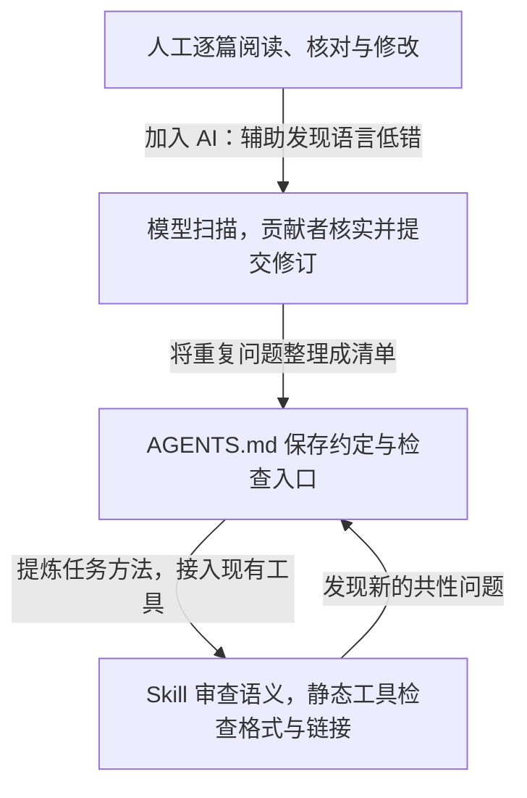
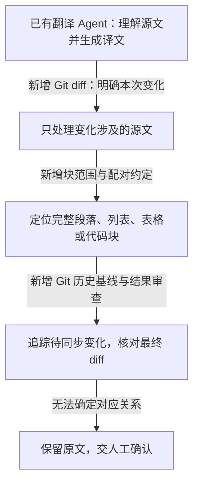
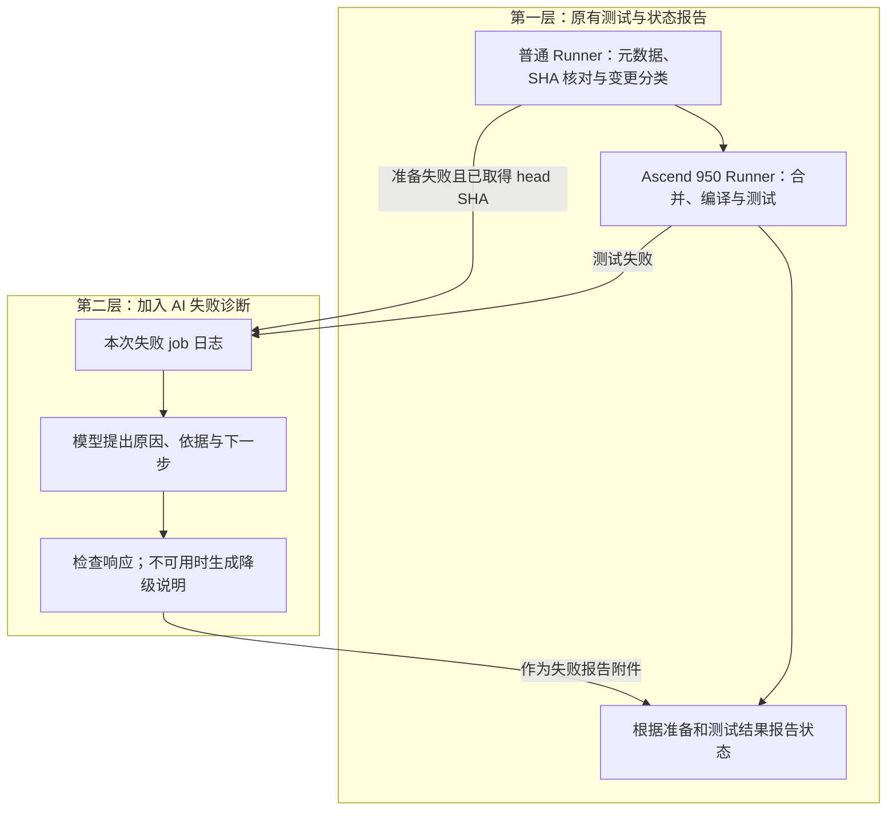
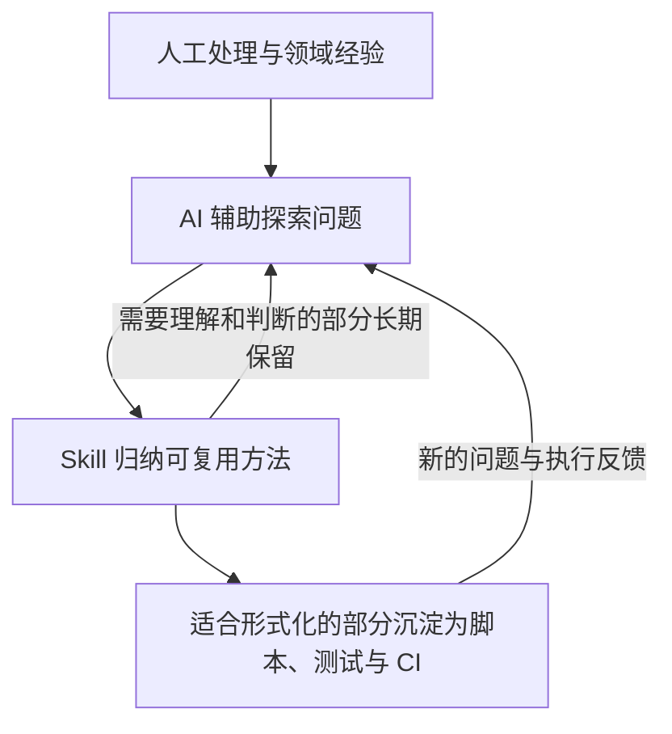

# 从文档治理到智能 CI：AI 与传统工程设施如何共同演进

> 基于 CATLASS 社区实践的案例讲义 · 配合约 30 分钟分享
> 核心观点：让 AI 的灵活理解，与传统工程设施的可重复执行、过程约束和验证反馈相结合。

## 从三个具体问题开始

文档改了多轮，相似的用词错误为什么还会出现？让 Agent 更新翻译，怎样避免它顺手重写未改动的段落？CI 已经能报告失败，为什么维护者还要花时间在日志里找原因？

这三个问题分别对应本文的三个案例：文档治理如何积累经验，Git 如何改善 Agent 的工作过程，AI 又如何扩展 CI 的反馈能力。

我参与其中一部分工作，也观察了社区其他贡献者的实践。下面引用集体成果讨论工程方法，不将所有代码、规则和改进归于个人。源码能说明机制；线上稳定性与效率收益仍需运行记录和评估支持。

## 案例一：文档治理，从逐篇整改到经验与工具协同

### 先看真正改过的东西

[#1304 对应提交](https://github.com/ascend-catlass/catlass/commit/df6e1f6af05403837c036999f8e7bf6f67273f03) 中，可以看到这样的真实修订。下方截取两处替换，省略周围上下文：

| 修订前 | 修订后 | 问题类型 |
| --- | --- | --- |
| 规约（描述 ReduceAdd 等累加操作） | 归约 | 技术术语 |
| `loadDataPrams` | `loadDataParams` | 标识符拼写 |

表格提取该提交中的两类实际修订，省略所在句子和代码上下文，完整修改以提交 diff 为准。

一个是技术术语，一个是代码标识符。修复结果很直观，但如果下一次仍靠审查者临时想起这些问题，同类错误还可能再出现。因此，这个提交同时把常见术语和易错项加入 AGENTS.md。

再看 [#1498](https://github.com/ascend-catlass/catlass/commit/3f250ec31864b821879d6e7e60d0dcfa2c8b3ce0)：整改继续扩展到规格来源、单位、示例和判断依据，并新增文档审查 Skill。改动留下的不只是更正后的文档，还有下一次能够复用的审查方法。

### 这项工作怎样发展

下图是能力演进的归纳。社区不同贡献者的工作存在交叠，箭头表示经验沉淀关系，不代表所有 PR 都按此顺序实施。



**第一步，人工整改。** 阅读技术文档时，贡献者结合源码和领域经验发现问题、修改并提交 PR。这里强调的是工作方式，不推断早期每个 PR 是否使用过 AI。

**第二步，加入 AI 扩大检查范围。** [#859](https://github.com/ascend-catlass/catlass/commit/0843e90ab3edaeccd149e19f01213575ab615770) 的合并说明同时记录了文档工具检查与大模型扫描；[#1483](https://github.com/ascend-catlass/catlass/commit/37cedeca455d0970f1724b0c23ab3d3fa4bdb08d) 明确记录了模型发现低错、Agent 辅助修复。AI 对文字与上下文的理解进入了已有整改流程。

**第三步，把反复使用的判断依据留下来。** #1304 将易错项整理到 AGENTS.md；#1498 新增专门的审查 Skill，并在 AGENTS.md 约定入口。当前分工是：AGENTS.md 说明何时检查、调用什么；Skill 说明怎样审查、关注哪些问题。经验不必每次重新写进提示词。

**第四步，让 Skill 与基础设施协同。** 当前[文档审查 Skill](https://github.com/ascend-catlass/catlass/blob/master/.agents/skills/catlass-docs-review/SKILL.md) 要求先运行静态检查，再审语义；范围限定为改动 hunk 及其直接影响的内容。

| 具体问题 | 当前适合承担的机制 |
| --- | --- |
| 格式、空白、换行等 | pre-commit 中的对应工具 |
| 相对链接与标题锚点 | Markdown 链接检查脚本 |
| 技术术语是否准确、规格有无来源 | Skill 指导模型结合上下文审查 |
| 修改是否符合技术事实 | 源码、官方资料与维护者复核 |

### 放大一个细节：一次断链修复怎样留下长期能力

[#1467](https://github.com/ascend-catlass/catlass/commit/6e5a75bd0f513907ba506dc310c80bf740d481ec) 修复存量断链，同时新增检查脚本与 pre-commit hook。下面是该提交新增 hook 的节选：

```yaml
- id: check-md-links
  name: check-md-links
  entry: python scripts/check_md_links.py
  args: ["--no-external"]
  language: python
  files: \.md$
```

关键在 `--no-external`：本地 hook 检查仓库内相对链接与锚点；外部网站的网络可达性没有被混入这条检查。脚本支持的能力与 hook 默认启用的范围，需要分开说明。

这不意味着模型无法检查链接。它意味着：把明确的检查交给可重复执行的程序，模型可以使用检查结果，继续关注技术含义。

**这一例留下的方法：AI 帮助处理问题，Skill 保存处理经验，工程设施让其中的检查持续执行。**

## 案例二：增量翻译，给 Agent 加上 Git 依据

### 先看 Skill 中的命令

已合入仓库的[翻译 Skill](https://github.com/ascend-catlass/catlass/blob/master/.agents/skills/catlass-docs-translation/SKILL.md) 首先要求取得当前任务的变更：

```bash
# 工作区相对 HEAD 的源文变化
git diff --unified=0 HEAD -- 'docs/zh/**/*.md'

# 分支相对共同祖先的源文变化
git diff --unified=0 upstream/master...HEAD -- 'docs/zh/**/*.md'
```

第一条看未提交修改，第二条看分支改动。它们回答“当前任务涉及哪些变化”，不能直接替代“自上次审核就绪后还有哪些翻译需要同步”的判断。

Skill 对后者另有约定：找到修改目标译文、且含 `Translation-Ready: true` 的最近合并提交，以该提交作为基线，再比较源文：

```bash
git fetch upstream master
git log --format='%H%n%B' -- <target.md>
git diff --unified=0 <ready-commit>..upstream/master -- <source.md>
```

这里的尖括号是待替换参数；`git log` 用于查找标记，本身不会自动完成基线选择。

### 一步步加进去了什么

下图按当前实现拆解能力叠加，是教学对照，不声称每层都曾独立部署。



假设一篇中文文档只改了一张参数表。这个例子用于解释机制，不是运行记录：

1. Git 给出变更行。
2. Agent 按 Skill 将 hunk 扩展到完整表格，避免只看几个单元格而丢失上下文。
3. 找到英文文档中的对应表格；无法对齐则报告人工处理。
4. 审核已有人工译文；已经符合变更后的含义就保留，否则只更新相关块。
5. 检查最终 diff，确认没有改动范围外的段落，没有错误改变链接、锚点和代码。

因此，增量翻译不仅是“少翻几行”，还在约束任务范围与复核范围。Git 记录源文变化，Skill 规定怎样处理，Agent 完成语言理解与块对齐。

当前实现明确以 Git 历史作为唯一翻译状态，不另建哈希缓存、映射配置或 Translation Memory。早期设计中的 AST 工具链和独立记忆库，不能写成这里已经实现的功能。

`Translation-Ready: true` 也是审核约定，不是正确性证明。Git 不知道译文有没有误解技术含义，审查者仍需检查完整性、术语与语义。

**这一例留下的方法：传统工程设施给 Agent 提供变化依据、修改约束和复核入口。**

## 案例三：TestPR，给已有 CI 加上日志理解

### 先看工作流中新增的连接点

[TestPR 工作流](https://github.com/ascend-catlass/actions/blob/main/.github/workflows/test-atomgit-pr.yml) 的 `analyze-failure` job 依赖准备和测试阶段，只在满足条件的失败路径执行。其调用节选如下：

```yaml
- name: Analyze failed workflow jobs
  id: diagnosis
  continue-on-error: true
  uses: ascend-catlass/actions/.github/actions/analyze-ci-failure@main
  with:
    github-token: ${{ github.token }}
    trae-pat: ${{ secrets.TRAE_CN_PAT }}
    run-id: ${{ github.run_id }}
    run-attempt: ${{ github.run_attempt }}
```

这里传入 run ID 和 attempt，让分析读取本次尝试的日志。Action 的下载步骤使用 GitHub 读取凭据；模型步骤使用单独的模型凭据。这个节选是复合 Action 的调用接口，不能据此误解为模型进程拿到了发布权限。

### 保留原有主干，再增加失败诊断

下面两层用于讲解当前工作流的能力结构，不作为历史上线顺序证明。



先解释原有基础：普通 Runner 获取 PR 元数据、核对获取到的 head SHA、按变更路径选择测试；需要硬件的任务再进入 Ascend 950 Runner。这样把任务准备与设备执行分开。SHA 核对使测试对象与取得的 PR 元数据保持对应，不能把旧版本结果当作新提交的证据。

再解释 AI 增量：测试失败后，维护者面对的可能是编译报错、Python 回溯、环境问题与设备日志的混合信息。模型用于整理这些非结构化信息，提出排查建议；编译器与测试框架仍产生执行结论。

当前[分析 Action](https://github.com/ascend-catlass/actions/blob/main/.github/actions/analyze-ci-failure/action.yml) 与[数据处理代码](https://github.com/ascend-catlass/actions/blob/main/.github/actions/analyze-ci-failure/comment.cjs) 还有几项具体约束：

| 位置 | 实现机制 | 作用与限度 |
| --- | --- | --- |
| 日志获取 | 指定 run attempt，最多取四个失败 job | 限定证据来源，可能不覆盖全部失败 |
| 提示准备 | 提取首批错误与尾部，执行脱敏 | 控制输入；截断可能丢上下文，脱敏也非绝对保证 |
| 模型执行 | 设置超时、要求结构化输出 | 约束运行与响应形态 |
| 结果处理 | 核对成功状态、字段及长度 | 检查可消费性，不能证明归因正确 |
| 报告阶段 | 无分析文件时补降级说明 | 保持原始失败可报告 |

`continue-on-error` 在这里服务于辅助诊断：分析失败不应阻断测试失败的报告。核心测试失败与辅助分析失败必须区分，不能把容错配置一概理解为吞掉测试错误。

严格按 Anthropic 的术语，这条链路的编排是固定 Workflow，包含模型分析步骤；不能仅凭模型调用就称为全自主 Agent。本文讨论的是 Agent/模型能力对传统设施的扩展，具体实现仍按实际架构描述。

**这一例留下的方法：AI 扩展 CI 对失败的理解，CI 为 AI 提供真实执行证据。**

## 从三个实现中提炼共同方法

Anthropic 的《Building effective agents》（2024-12-19）区分固定代码路径的 Workflow 与模型动态选择步骤的 Agent，并主张先采用满足需求的简单方案，再依据效果增加复杂度。文中也强调执行反馈、检查点和停止条件。[原文](https://www.anthropic.com/research/building-effective-agents)

这为案例提供解释框架；“把重复经验沉淀成 Skill，再将适合的规则交给程序”是本文结合社区实践提出的工程归纳。

| 组成 | 主要职责 | 本文中的位置 |
| --- | --- | --- |
| Script | 实现明确操作与检查 | 链接检查、日志裁剪与报告组装 |
| Action / Tool | 提供有接口的可复用能力 | CI 失败分析 Action、Git 工具 |
| Workflow | 预先定义阶段与连接关系 | PR 准备、测试、诊断、报告 |
| Skill | 提供任务知识、约束与工作方法 | 文档审查、增量翻译 |
| Agent | 根据反馈选择步骤和工具 | 按 Skill 阅读、对齐与修改文档的执行者 |

它们可以组合。一次模型调用、一个 Skill 文件与一个自主 Agent，也不是同一件事。

Google SRE 关于重复劳动与自动化一致性的讨论，同样提醒我们关注能够持续保留的工程价值。[Eliminating Toil](https://sre.google/workbook/eliminating-toil/) · [The Evolution of Automation at Google](https://sre.google/sre-book/automation-at-google/)



这是一种知识积累循环，不是要求所有 Skill 最终变成脚本。基础设施与 AI 也不必按唯一顺序引入，现有工具可以从第一天就参与。

## 适用边界：怎样判断结合后是否更可靠

确定性意味着在给定条件下按规则执行，不意味着工具没有缺陷。错误的链接规则、漏选的测试与不完整日志，都可能给模型提供错误依据。Skill 也可能过时，需要像代码一样审查和维护。

因此，“更可靠”在这里首先是设计目标与机制解释，尚不能当作已量化的运行结论。后续可分别记录：文档复发问题与误报、翻译越界修改与遗漏、CI 诊断是否被维护者采纳及其依据是否正确，同时统计成本、时延与降级情况。没有这些数据，不声称稳定性或效率提升了某个百分比。

技术事实有争议、块对齐存在歧义、验证范围不足时，应允许转人工。简单任务可以使用一次模型调用与现成工具；复杂开放任务再考虑动态 Agent。

三个案例共同展示了一个可复用方向：经验通过规则与 Skill 留下来，Git 让修改有据可查，真实测试与 AI 诊断彼此补充。

**让 AI 的灵活性，与传统工程设施的确定性相结合。**
